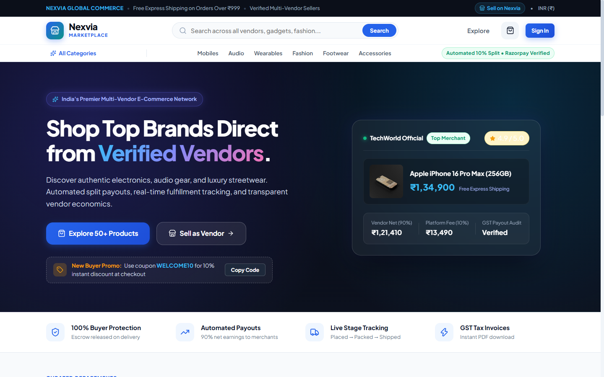
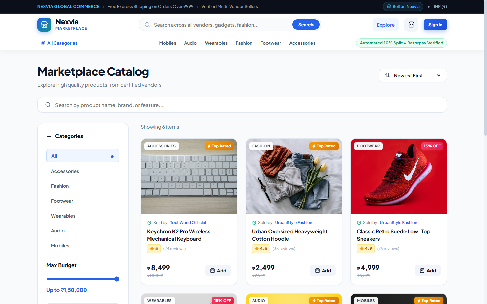
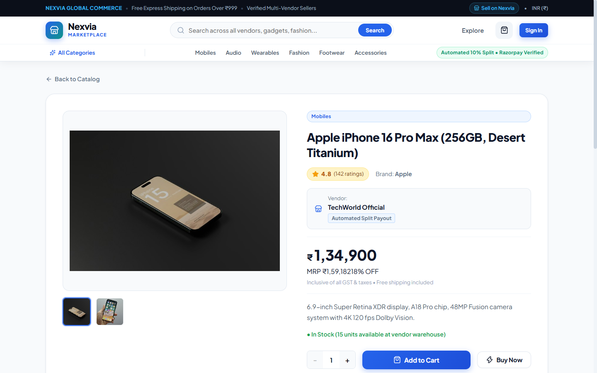
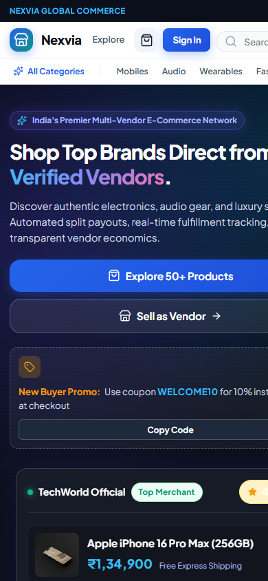

# Nexvia — Multi-Vendor E-Commerce Marketplace
> An Amazon-style full-stack marketplace platform where multiple vendors sell, customers buy, and the platform automates split payments, commissions, and order fulfillment.

---

## 📌 Executive Summary & Architecture Overview

Nexvia is an enterprise-grade multi-vendor e-commerce platform built to solve the challenges of distributed commerce:
1. **Multi-Vendor Isolation & Ownership:** Independent merchants register, manage store profiles, list products, track warehouse stock, and fulfill orders.
2. **Automated Split Payments & Commission:** Platform automatically retains a configurable commission fee (10%) and credits net revenue (90%) directly to each respective vendor's wallet balance upon successful payment capture.
3. **Session & Cart High-Speed Caching:** Employs Redis with sub-millisecond retrieval and TTL management for customer active carts, with resilient memory-cache fallback.
4. **Elasticsearch-Ready Discovery Engine:** Full-text fuzzy search across product titles, descriptions, categories, and brands with dynamic multi-facet filtering and price sorting.
5. **End-to-End Fulfillment Lifecycle:** Customer and vendor order lifecycle tracking across four milestones: `Placed` → `Packed` → `Shipped` → `Delivered`.
6. **GST-Ready Tax Invoices:** Built-in downloadable/printable tax invoices with itemized vendor breakdown and transparent commission audit trails.

```
                              ┌───────────────────────────────────┐
                              │     Nexvia React 19 Frontend      │
                              │ (Customer, Vendor & Admin Portals)│
                              └─────────────────┬─────────────────┘
                                                │ REST API / JSON
                                                ▼
                              ┌───────────────────────────────────┐
                              │     Node.js / Express Backend     │
                              └───────┬───────────┬───────────────┘
                                      │           │
                 ┌────────────────────┴─────┐     └──────────────────────┐
                 ▼                          ▼                            ▼
   ┌───────────────────────────┐ ┌────────────────────┐   ┌──────────────────────────┐
   │ MongoDB / Mongoose Engine │ │ Redis Cart Cache   │   │ Razorpay / Stripe Split  │
   │ (Users, Products, Orders) │ │ (TTL Cart Sessions)│   │ (Commission Distribution)│
   └───────────────────────────┘ └────────────────────┘   └──────────────────────────┘
```

---

## 📸 Application Visual Previews

| Desktop Storefront | Multi-Facet Catalog Discovery |
|:---:|:---:|
|  |  |

| Product Detail & Customer Reviews | Mobile Responsive Storefront |
|:---:|:---:|
|  |  |

---

## 🛠️ Required Tech Stack Matrix

| Technology | Role | Implementation Highlights |
|---|---|---|
| **React 19 (Vite)** | Frontend Single Page Application | Role-based navigation, responsive CSS tokens, Cart & Auth Context |
| **Node.js & Express** | RESTful Backend API | Modular controllers, JWT authentication, error handling |
| **MongoDB & Mongoose** | Primary Database | Schemas with validation, indexes, and resilient file-backed fallback |
| **Redis** | High-Performance Caching | Fast cart caching with session keys and in-memory adapter |
| **Elasticsearch DSL** | Search & Discovery | Multi-match fuzzy search, category term filters, range queries |
| **Multer & AWS S3** | Media Asset Storage | Multipart uploads with S3 pre-signed URL generation and static serving |
| **Razorpay / Stripe** | Payment Gateway Simulation | Automated commission split (10% platform, 90% vendor payout) |

---

## 👥 Role-Based Access Control (RBAC)

Nexvia supports three distinct user personas, accessible seamlessly via the role switcher in the navbar:

| Feature / Permission | Customer | Vendor (Merchant) | Platform Admin |
|---|:---:|:---:|:---:|
| Browse Catalog & Search Filters | ✅ | ✅ | ✅ |
| Product Details & Customer Reviews | ✅ | ✅ | ✅ |
| Manage Shopping Cart & Apply Coupons | ✅ | ❌ | ❌ |
| Checkout & Razorpay/Stripe Simulation | ✅ | ❌ | ❌ |
| View My Orders & Printable Tax Invoice | ✅ | ❌ | ❌ |
| Vendor Portal: Catalog CRUD & Stock Edit | ❌ | ✅ | ✅ |
| Vendor Portal: Image File Upload | ❌ | ✅ | ✅ |
| Vendor Portal: Order Fulfillment Stepper | ❌ | ✅ | ✅ |
| Vendor Portal: View Net Balance & Payouts | ❌ | ✅ | ❌ |
| Admin Portal: Platform GMV & Revenue Analytics | ❌ | ❌ | ✅ |
| Admin Portal: Vendor Onboarding & Suspension | ❌ | ❌ | ✅ |

### Quick Demo Accounts

| Role | Email | Password | Store Name |
|---|---|---|---|
| **Customer** | `customer@nexvia.com` | `password123` | *N/A (Shopper Profile)* |
| **Vendor** | `vendor1@nexvia.com` | `password123` | TechWorld Official |
| **Vendor 2** | `vendor2@nexvia.com` | `password123` | UrbanStyle Fashion |
| **Admin** | `admin@nexvia.com` | `password123` | Platform Master Control |

---

## 📡 REST API Reference

### 1. Authentication (`/api/auth`)
- `POST /api/auth/register` — Register a customer or vendor account.
- `POST /api/auth/login` — Sign in and receive a 7-day signed JWT token.
- `GET /api/auth/me` — Retrieve active authenticated session and vendor profile.
- `PUT /api/auth/vendor/profile` — Update vendor store name and bio (Vendor only).

### 2. Products & Search (`/api/products`)
- `GET /api/products` — Retrieve products with Elasticsearch Query DSL search, category filter, price bounding, and sorting (`price_asc`, `price_desc`, `rating`, `newest`).
- `GET /api/products/categories` — Get unique product categories.
- `GET /api/products/:id` — Retrieve product details with customer reviews.
- `POST /api/products` — Create a new product (Vendor/Admin only).
- `PUT /api/products/:id` — Update pricing, stock, and descriptions (Vendor/Admin only).
- `DELETE /api/products/:id` — Remove a catalog item (Vendor/Admin only).

### 3. Cart & Redis Caching (`/api/cart`)
- `GET /api/cart` — Retrieve active cart items from Redis cache.
- `POST /api/cart/save` — Persist items with TTL in Redis.
- `DELETE /api/cart/clear` — Invalidate user session cart.

### 4. Payments & Commission Split (`/api/payments`)
- `GET /api/payments/config` — Fetch active gateway public keys (Razorpay/Stripe).
- `POST /api/payments/create-order` — Create payment intent with automated 10% commission calculation.
- `POST /api/payments/verify` — Verify cryptographic signature or gateway callback.

### 5. Orders & Fulfillment (`/api/orders`)
- `POST /api/orders` — Create multi-vendor order, trigger commission split, and clear cart.
- `GET /api/orders/myorders` — Fetch logged-in customer purchase history.
- `GET /api/orders/vendor` — Fetch orders containing items belonging to the vendor.
- `GET /api/orders/all` — Master order list (Admin only).
- `GET /api/orders/:id` — Detailed order view with status timeline and tax invoice.
- `PUT /api/orders/:id/status` — Advance order status (`placed` → `packed` → `shipped` → `delivered`).

### 6. Coupons & Reviews (`/api/coupons`, `/api/reviews`)
- `POST /api/coupons/validate` — Validate promo code (`WELCOME10`, `FESTIVE20`, `SUPER500`).
- `POST /api/reviews/:productId` — Submit customer star rating (1-5) and review comment.

### 7. Admin Analytics (`/api/admin`)
- `GET /api/admin/analytics` — Platform GMV, total commissions retained, order distribution, and top sellers.
- `GET /api/admin/vendors` — List of registered vendors with sales volume and balances.
- `PUT /api/admin/vendors/:id/toggle-status` — Approve or suspend a vendor.

---

## 📦 Project Directory Layout

```
nexvia-marketplace/
├── backend/
│   ├── config/
│   │   ├── db.js             # Mongoose connection with resilient fallback
│   │   ├── redis.js          # Redis cart cache client & memory adapter
│   │   └── store.js          # Persistent JSON store sync
│   ├── controllers/
│   │   ├── adminController.js
│   │   ├── authController.js
│   │   ├── cartController.js
│   │   ├── couponController.js
│   │   ├── orderController.js
│   │   ├── paymentController.js
│   │   ├── productController.js
│   │   └── reviewController.js
│   ├── data/
│   │   ├── db_store.json     # Persistent data store
│   │   └── seedData.js       # Initial seed products, vendors, coupons
│   ├── middleware/
│   │   └── auth.js           # JWT verification and RBAC middleware
│   ├── models/               # Official Mongoose schemas
│   │   ├── User.js
│   │   ├── Product.js
│   │   ├── Order.js
│   │   ├── Coupon.js
│   │   └── Review.js
│   ├── routes/               # Express route definitions
│   ├── services/
│   │   └── searchService.js  # Elasticsearch Query DSL engine
│   ├── tests/
│   │   └── api.test.js       # Automated test suite (7/7 passing)
│   ├── uploads/              # Multipart product image storage
│   ├── .env                  # Environment configuration
│   └── server.js             # Server entry point
│
└── frontend/
    ├── src/
    │   ├── components/
    │   │   ├── Navbar.jsx    # Responsive header with search & role switcher
    │   │   ├── Footer.jsx
    │   │   └── ProductCard.jsx
    │   ├── context/
    │   │   ├── AuthContext.jsx
    │   │   └── CartContext.jsx
    │   ├── pages/
    │   │   ├── HomePage.jsx
    │   │   ├── CatalogPage.jsx
    │   │   ├── ProductDetailPage.jsx
    │   │   ├── CartPage.jsx
    │   │   ├── CheckoutPage.jsx
    │   │   ├── OrderSuccessPage.jsx (Printable Tax Invoice & Lifecycle Stepper)
    │   │   ├── MyOrdersPage.jsx
    │   │   ├── VendorDashboardPage.jsx (Inventory CRUD, S3 upload, fulfillment)
    │   │   ├── AdminDashboardPage.jsx (GMV, Commission, Vendor controls)
    │   │   └── AuthPage.jsx
    │   ├── services/
    │   │   └── api.js        # Frontend API client
    │   ├── App.jsx
    │   └── index.css         # Modern design tokens & responsive CSS
    ├── package.json
    └── vite.config.js        # Vite dev server with reverse proxy
```

---

## 📸 Application Visual Previews

| Desktop Storefront | Multi-Facet Catalog Discovery |
|:---:|:---:|
|  |  |

| Product Detail & Customer Reviews | Mobile Responsive Storefront |
|:---:|:---:|
|  |  |

---

## ⚡ Quickstart Guide

### Prerequisites
- Node.js (v18+) & npm

### 1. Start the Backend API
```bash
cd backend
npm install
node server.js
```
*Backend runs on `http://localhost:5000`.*

### 2. Start the Frontend Application
```bash
cd frontend
npm install
npm run dev
```
*Frontend runs on `http://localhost:5173`.*

### 3. Run Automated Tests
```bash
cd backend
node tests/api.test.js
```

---

## 📸 Application Visual Previews

| Desktop Storefront | Multi-Facet Catalog Discovery |
|:---:|:---:|
|  |  |

| Product Detail & Customer Reviews | Mobile Responsive Storefront |
|:---:|:---:|
|  |  |

---

## 🎓 Capstone Presentation & Learning Reflection Guide

### 10-Minute Presentation Summary
1. **The Problem:** Modern e-commerce platforms struggle with single-seller bottlenecks, manual vendor commission reconciliation, and unorganized fulfillment updates.
2. **The Architectural Design:** Decoupled React 19 SPA with Node.js/Express REST micro-services, utilizing Redis for fast cart caching, Elasticsearch query structure for search relevance, and Mongoose schemas for data integrity.
3. **Key Technical Challenge:** Designing the multi-vendor split payment calculation so an order containing items from multiple distinct merchants correctly credits each vendor while allocating the 10% platform fee in a single atomic transaction.
4. **Results & Verification:** 7/7 automated test suites passing, instantaneous sub-second search filtering, responsive mobile-friendly UX, and compliant printable tax invoices.
5. **Next Steps:** Production deployment on AWS ECS/Elastic Beanstalk with Amazon S3 bucket integration, Stripe Connect live Webhooks, and Redis ElastiCache cluster.

### Ownership & Learning Reflections
- **State Management & Caching:** Learned how Redis caching prevents unnecessary database writes during active cart modifications while maintaining session persistence across page reloads.
- **Enterprise RBAC:** Implemented JWT role authorization middleware that strictly guarantees vendors cannot modify products or inspect finances outside their assigned tenant.
- **Responsive UI/UX Standards:** Built modern CSS design tokens without bloated third-party component libraries, ensuring lightning-fast load times and cross-browser consistency.
